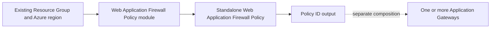
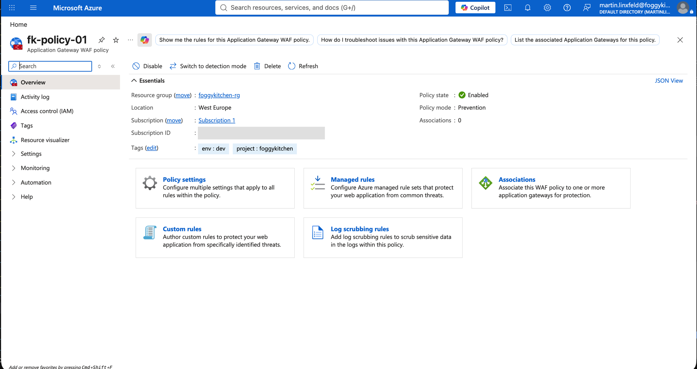
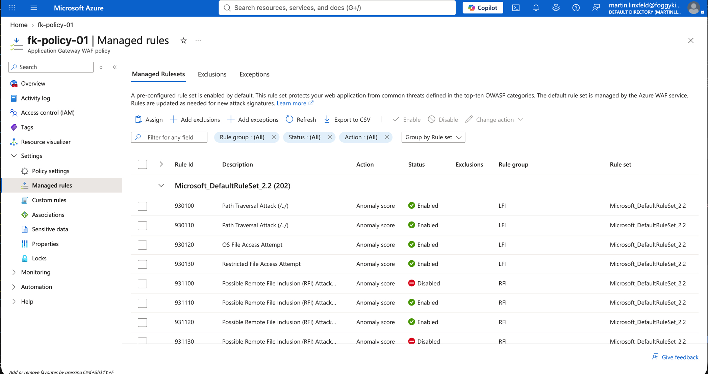
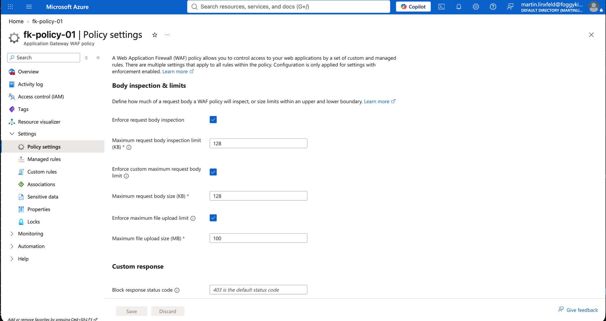

# Example 01: Basic Prevention Policy (Web Application Firewall Policy Basics)

In this first Web Application Firewall Policy example, we deploy a **standalone Azure Web Application Firewall Policy** in **Prevention mode**, using **Microsoft Default Rule Set 2.2** with **Terraform / OpenTofu**.

This example introduces the smallest complete policy contract and is intentionally kept simple: no custom rules, exclusions, gateway, or networking. Its purpose is to establish a **clean, understandable baseline** for a shared application security artifact.

---

## 🧭 Architecture Overview

The example uses an **existing Resource Group** and creates only the Web Application Firewall Policy. The consuming Application Gateway and its networking remain outside this example.



*Figure 1. Independent policy lifecycle and explicit policy-ID composition. The dashed gateway connection is supplied by the consumer.*

This example creates:

- One Azure Web Application Firewall Policy in an existing Resource Group
- Enabled request body inspection
- 100 MB file upload limit and 128 KB body size/inspection limits
- Microsoft Default Rule Set 2.2 without overrides
- A policy-ID output for independently managed gateways

This is a **learning-focused policy example**. It does not inspect traffic until separately attached to a compatible gateway.

---

## 🎯 Why this example exists

Before adding custom rules, exclusions, or managed rule overrides, understand how policy mode and the baseline rule set determine application inspection. The policy is a separately governed resource; it does not receive traffic on its own.

---

## 🚀 Deployment Steps

Use AzureRM **4.81.0** for the verified schema. Copy the nonsecret variables file and set the name of an existing Resource Group:

```bash
cp terraform.tfvars.example terraform.tfvars
tofu fmt -check
tofu init
tofu validate
```

The variables file must provide `resource_group_name`. The Azure region defaults to `westeurope` and must match the consuming gateway.

For an intentional deployment to your own subscription:

```bash
tofu plan -var-file=terraform.tfvars
tofu apply -var-file=terraform.tfvars
```

This example was deployed and verified against Azure on **2026-10-05**, using the externally supplied variables file. `tofu apply` created one policy with no changes or deletions. An Azure CLI read confirmed provisioning state `Succeeded`, policy state `Enabled`, Prevention mode, Microsoft Default Rule Set 2.2, 128 KB body size/inspection limits, 100 MB upload limit, and both enforcement switches enabled. Custom rules, exclusions, and managed rule overrides were empty.

The policy was deployed as `fk-policy-01` in `foggykitchen-rg`, region `westeurope`. The existing-resource-group prerequisite was created separately through Azure CLI and is outside this example’s OpenTofu state. No gateway was attached, so traffic blocking has not been tested. Configure Azure authentication and subscription selection in your environment.

Attach the resulting `waf_policy_id` through the `firewall_policy_id` input of [terraform-az-fk-application-gateway](https://github.com/foggykitchen/terraform-az-fk-application-gateway), using its `WAF_v2` SKU. Gateway diagnostics and the Log Analytics destination belong to that consumer.

---

## 🖼️ Azure Portal View

The following Azure Portal screenshots confirm the deployed configuration of `fk-policy-01`.



*Figure 2. Web Application Firewall Policy `fk-policy-01` in `foggykitchen-rg`, West Europe, with state Enabled, mode Prevention, and zero gateway associations.*



*Figure 3. Microsoft Default Rule Set 2.2 and its managed rule states and anomaly-scoring actions. Some rules are disabled in the baseline; the Azure CLI verification confirmed that no rule group overrides were configured by this example.*



*Figure 4. Enabled request body inspection with a 128 KB inspection limit, enforced 128 KB maximum request body size, and enforced 100 MB maximum file upload size.*

These screenshots verify policy configuration. Traffic inspection and blocking require a separate Application Gateway attachment and have not been tested in this example.

---

## 🧹 Cleanup

Detach consuming gateways before deleting a shared policy. If you deployed this example and it is no longer needed:

```bash
tofu destroy -var-file=terraform.tfvars
```

The existing Resource Group and separately managed gateways are outside this example's lifecycle.

---

## 🪪 License

Licensed under the **Universal Permissive License (UPL), Version 1.0**.
See [LICENSE](../../LICENSE) for details.

© 2026 [FoggyKitchen.com](https://foggykitchen.com) - Cloud. Code. Clarity.
