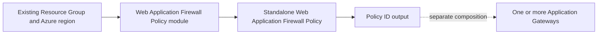
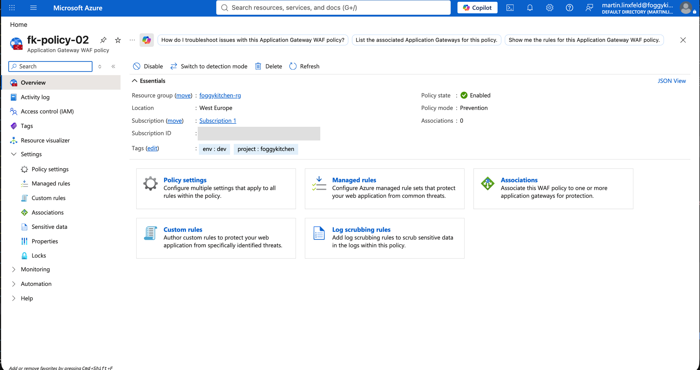
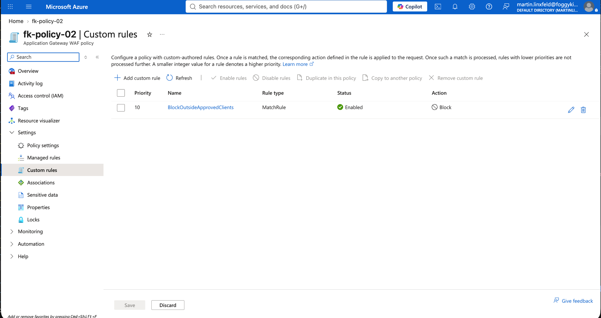
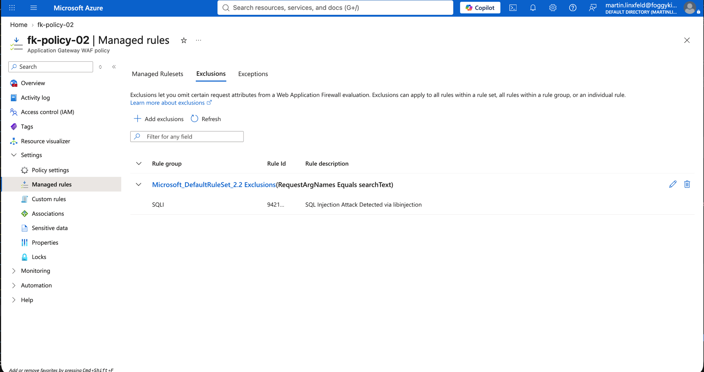

# Example 02: Policy with Custom Rules and Exclusions

In this second Web Application Firewall Policy example, we add a **custom IP boundary rule** and a **rule-scoped argument exclusion** to the Prevention baseline using **Terraform / OpenTofu**.

This example demonstrates precise policy customization while keeping the gateway lifecycle separate. It uses a negated-IP **Block** rule so approved clients still pass through managed inspection.

---

## 🧭 Architecture Overview

The example uses an **existing Resource Group** and creates only the Web Application Firewall Policy. The consuming Application Gateway and its networking remain outside this example.



*Figure 1. Independent policy lifecycle and explicit policy-ID composition. The dashed gateway connection is supplied by the consumer.*

This example creates:

- One Azure Web Application Firewall Policy using Microsoft Default Rule Set 2.2
- Custom rule BlockOutsideApprovedClients with priority 10
- Negated RemoteAddr IPMatch against the documentation-only range 203.0.113.0/24
- An exact searchText argument exclusion scoped to SQLI rule 942100
- A policy-ID output for independently managed gateways

This is a **learning-focused policy example**. It does not inspect traffic until separately attached to a compatible gateway.

---

## 🎯 Why this example exists

A custom Allow rule can bypass later managed inspection. A negated-IP Block rule rejects clients outside the approved ranges and allows the remaining traffic to continue through managed rules. The scoped exclusion demonstrates how to tune a known false positive without removing an entire rule globally.

Replace `203.0.113.0/24` with approved client ranges before deployment. The `searchText` exclusion is illustrative and must be justified using your own false-positive evidence.

---

## 🚀 Deployment Steps

Use AzureRM **4.81.0** for the verified schema. Copy the nonsecret variables file and set the name of an existing Resource Group:

```bash
cp terraform.tfvars.example terraform.tfvars
tofu fmt -check
tofu init
tofu validate
```

The variables file must provide `resource_group_name`. The Azure region defaults to `westeurope` and must match the consuming gateway.

For an intentional deployment to your own subscription:

```bash
tofu plan -var-file=terraform.tfvars
tofu apply -var-file=terraform.tfvars
```

This example was deployed and verified against Azure on **2026-10-05** using the externally supplied variables file. `tofu apply` created one policy with no changes or deletions. An Azure CLI read confirmed `fk-policy-02` in `foggykitchen-rg`, region `westeurope`, provisioning state `Succeeded`, policy state `Enabled`, Prevention mode, and Microsoft Default Rule Set 2.2.

The deployed custom rule `BlockOutsideApprovedClients` is enabled, uses priority 10 and action Block, and matches `RemoteAddr` with a negated `IPMatch` against `203.0.113.0/24`. The `RequestArgNames` exclusion selects `searchText` with `Equals` and applies only to SQLI rule `942100` in DRS 2.2. Body size/inspection limits are 128 KB and the file upload limit is 100 MB, with enforcement enabled. No gateway was attached, so traffic blocking and exclusion behavior have not been tested.

Attach the resulting `waf_policy_id` through the `firewall_policy_id` input of [terraform-az-fk-application-gateway](https://github.com/foggykitchen/terraform-az-fk-application-gateway), using its `WAF_v2` SKU. Gateway diagnostics and the Log Analytics destination belong to that consumer.

---

## 🖼️ Azure Portal View

The following Azure Portal screenshots confirm the deployed policy overview, custom rule summary, and scoped exclusion.



*Figure 2. Web Application Firewall Policy `fk-policy-02` in `foggykitchen-rg`, West Europe, with state Enabled, mode Prevention, and zero gateway associations.*



*Figure 3. Enabled custom rule `BlockOutsideApprovedClients`, with priority 10, type MatchRule, and action Block.*



*Figure 4. RequestArgNames Equals searchText exclusion scoped to Microsoft Default Rule Set 2.2 and the SQLI group, showing the SQL injection detection rule. The portal truncates the rule ID in this view; the Azure CLI read confirmed its full value as `942100`.*

The custom rule summary does not show its IP range or negation; those settings were confirmed by the Azure CLI read described above.

These screenshots verify configuration only. Traffic blocking and exclusion behavior require a separate Application Gateway attachment and have not been tested in this example.

---

## 🧹 Cleanup

Detach consuming gateways before deleting a shared policy. If you deployed this example and it is no longer needed:

```bash
tofu destroy -var-file=terraform.tfvars
```

The existing Resource Group and separately managed gateways are outside this example's lifecycle.

---

## 🪪 License

Licensed under the **Universal Permissive License (UPL), Version 1.0**.
See [LICENSE](../../LICENSE) for details.

© 2026 [FoggyKitchen.com](https://foggykitchen.com) - Cloud. Code. Clarity.
