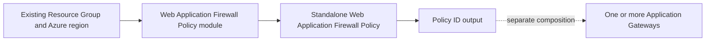
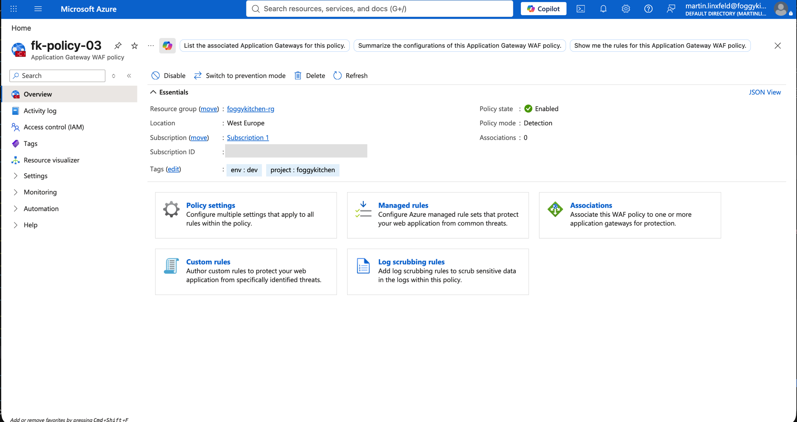
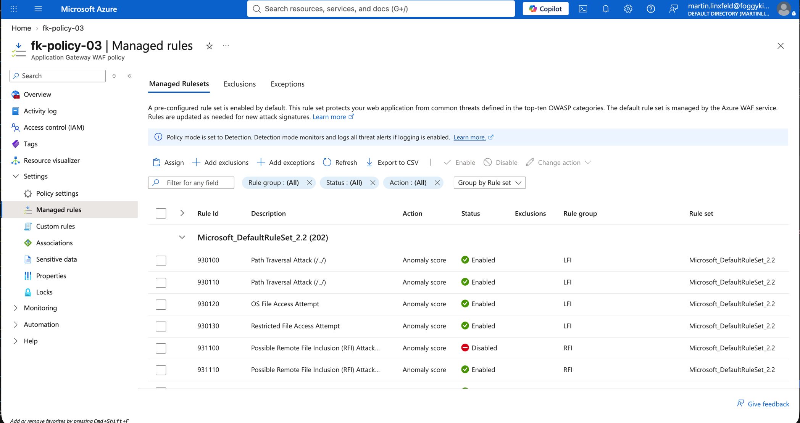
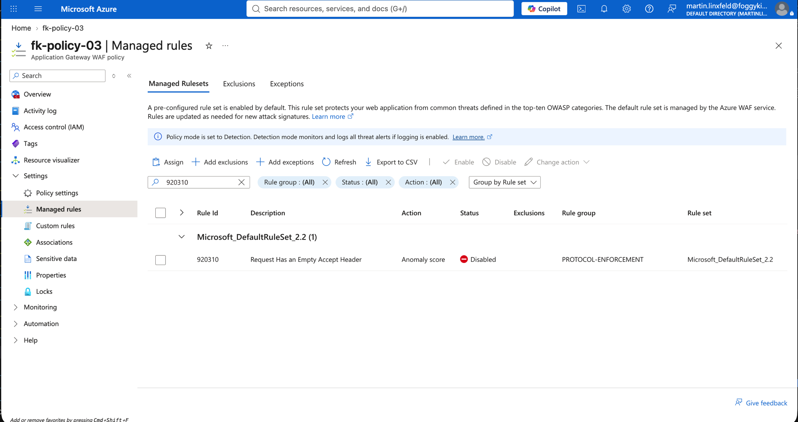

# Example 03: Detection Mode with Rule Overrides

In this third Web Application Firewall Policy example, we configure **Detection mode** and a **managed rule group override** for realistic tuning before Prevention using **Terraform / OpenTofu**.

Detection mode is **log-only**: matching requests are permitted. The example explicitly disables rule **920310** (empty Accept header) in DRS 2.2 group **PROTOCOL-ENFORCEMENT**.

---

## 🧭 Architecture Overview

The example uses an **existing Resource Group** and creates only the Web Application Firewall Policy. The consuming Application Gateway and its networking remain outside this example.



*Figure 1. Independent policy lifecycle and explicit policy-ID composition. The dashed gateway connection is supplied by the consumer.*

This example creates:

- One Azure Web Application Firewall Policy in Detection mode
- Microsoft Default Rule Set 2.2
- A PROTOCOL-ENFORCEMENT group override with rule 920310 disabled
- A policy-ID output for independently managed gateways

This is a **learning-focused policy example**. It does not inspect traffic until separately attached to a compatible gateway.

---

## 🎯 Why this example exists

Application-specific tuning should be based on gateway logs before enforcing Prevention. This example demonstrates the current rule { id, enabled } syntax and a single explicit disable; it is not a universal recommendation to disable rule 920310.

---

## 🚀 Deployment Steps

Use AzureRM **4.81.0** for the verified schema. Copy the nonsecret variables file and set the name of an existing Resource Group:

```bash
cp terraform.tfvars.example terraform.tfvars
tofu fmt -check
tofu init
tofu validate
```

The variables file must provide `resource_group_name`. The Azure region defaults to `westeurope` and must match the consuming gateway.

For an intentional deployment to your own subscription:

```bash
tofu plan -var-file=terraform.tfvars
tofu apply -var-file=terraform.tfvars
```

This example was deployed and verified against Azure on **2026-10-05** using the externally supplied variables file. `tofu apply` created one policy with no changes or deletions. An Azure CLI read confirmed `fk-policy-03` in `foggykitchen-rg`, region `westeurope`, provisioning state `Succeeded`, policy state `Enabled`, and Detection mode.

The managed rule set is Microsoft Default Rule Set 2.2. Its `PROTOCOL-ENFORCEMENT` override explicitly sets rule `920310` to `Disabled`. Custom rules and exclusions are empty. Body size/inspection limits are 128 KB and the file upload limit is 100 MB. No gateway was attached, so request logging and nonblocking behavior have not been tested.

Attach the resulting `waf_policy_id` through the `firewall_policy_id` input of [terraform-az-fk-application-gateway](https://github.com/foggykitchen/terraform-az-fk-application-gateway), using its `WAF_v2` SKU. Gateway diagnostics and the Log Analytics destination belong to that consumer.

---

## 🖼️ Azure Portal View

The following Azure Portal screenshots confirm the deployed Detection-mode policy and managed rule override.



*Figure 2. Web Application Firewall Policy `fk-policy-03` in `foggykitchen-rg`, West Europe, with state Enabled, mode Detection, and zero gateway associations.*



*Figure 3. Microsoft Default Rule Set 2.2 and the portal's Detection-mode notice, which states that threat alerts are logged when logging is enabled.*



*Figure 4. Filtered rule `920310` (Request Has an Empty Accept Header), shown as Disabled in the PROTOCOL-ENFORCEMENT group of Microsoft Default Rule Set 2.2.*

These screenshots verify configuration only. No gateway was attached, so request logging and nonblocking behavior have not been tested. Enable diagnostics on every consuming gateway and review logs before switching to Prevention.

---

## 🧹 Cleanup

Detach consuming gateways before deleting a shared policy. If you deployed this example and it is no longer needed:

```bash
tofu destroy -var-file=terraform.tfvars
```

The existing Resource Group and separately managed gateways are outside this example's lifecycle.

---

## 🪪 License

Licensed under the **Universal Permissive License (UPL), Version 1.0**.
See [LICENSE](../../LICENSE) for details.

© 2026 [FoggyKitchen.com](https://foggykitchen.com) - Cloud. Code. Clarity.
